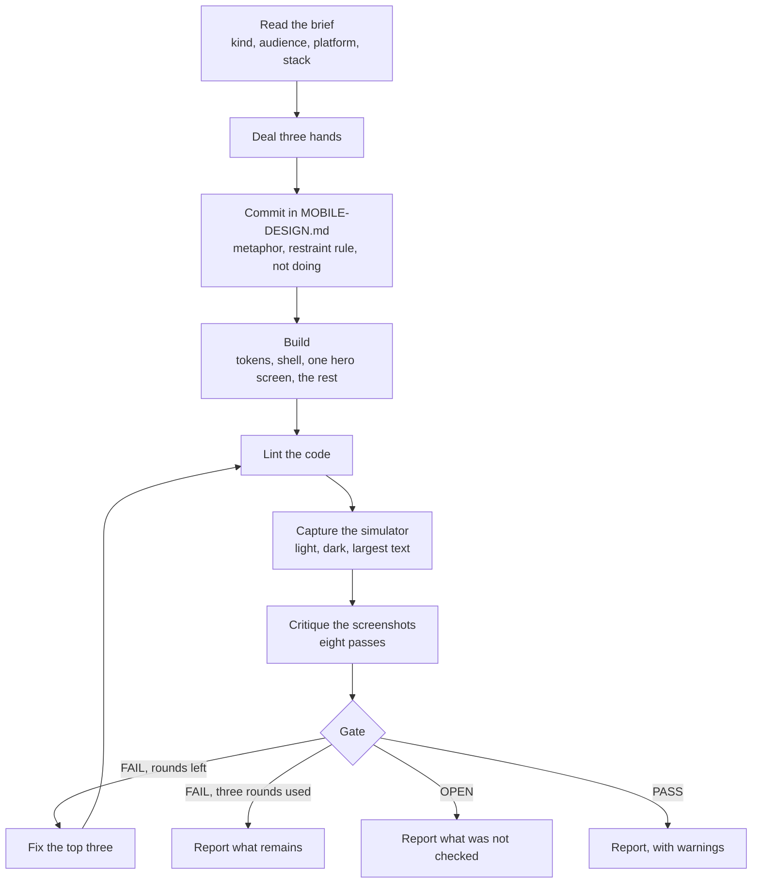
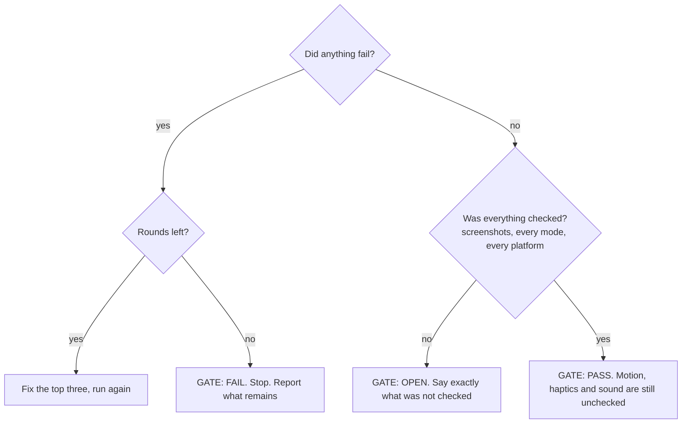

# taste-mobile

Art direction and design review for mobile apps, as an agent skill.
SwiftUI, Jetpack Compose and React Native/Expo.

**[Site](https://therynamo.github.io/taste-mobile/)** · **[Guide](https://therynamo.github.io/taste-mobile/guide.html)** · **[Examples](examples/)** · MIT

An app built by an agent with no direction comes out the same every time: a centred balance over
round buttons, a tinted chat bubble over a circular menu, a card on every row. taste-mobile
replaces that default with three things:

1. **A dealt direction.** One of 16 directions, each seen in shipped apps from at least two makers.
2. **A written commitment.** A metaphor, a rule the app will not break, and three things it refuses.
3. **A check the agent cannot talk its way past.** Lint, simulator screenshots, critique, gate.

## Install

```sh
npx skills add https://github.com/therynamo/taste-mobile --skill "taste-mobile"
```

Claude Code plugin:

```
/plugin marketplace add therynamo/taste-mobile
/plugin install taste-mobile@taste-mobile
```

From a clone (links, so `git pull` updates it):

```sh
git clone https://github.com/therynamo/taste-mobile && cd taste-mobile
./install.sh              # Claude Code. Add --codex or --all-agents for others
```

Needs Node 18 or later. Screenshots need Xcode and a booted iOS simulator.

## Use

Ask for an app and name the skill:

> Use taste-mobile. Build an iPhone app for a couple who share one monthly budget. SwiftUI.

Other things it does:

| You want | Say |
|---|---|
| A redesign that keeps your brand | "Use taste-mobile to redesign the home screen. Keep our colours and logo." |
| A review, no build | "Use taste-mobile to review these screens. What reads as a default?" |
| A direction you already chose | "Use taste-mobile with the glance-board direction." |

## How a run goes



## What the verdict means



`GATE: PASS` covers what code and stills can show. It never covers motion, haptics or sound.

## What is in the box

```
skills/taste-mobile/
  SKILL.md             the run, the house rules, the tells
  scripts/deal.mjs     deals three hands, writes MOBILE-DESIGN.md
  scripts/lint.mjs     40 rules: motion, haptics, sound, tells, money, accessibility, platform
  scripts/capture.mjs  drives a booted simulator: light, dark, largest text
  scripts/gate.mjs     GATE: PASS | FAIL | OPEN, three rounds at most
  data/                16 directions, 14 app kinds, the dealt slots
  references/          iOS, Android, stacks, motion, haptics and sound, assets, tells,
                       verification, and six modules: money, crypto, chat and AI,
                       sports, fitness, feed
examples/              one brief dealt four ways
research/corpus/       the 114 apps the directions came from, as notes (no screenshots)
tests/                 node --test tests/*.test.mjs
```

The scripts have no dependencies.

## Get the best results

- **Give a real brief.** Who uses it, what they do most, what platform. One sentence each.
- **Take hand 1.** Dealing again until you like it is choosing from memory with extra steps.
- **Hand over brand assets if you have them.** Colour, type and logo replace the dealt ones.
- **Boot a simulator first.** Without one the gate holds at `OPEN` and nothing was seen running.
- **Read `MOBILE-DESIGN.md` before the build.** It is one page. It is the cheapest place to disagree.
- **Check motion and haptics on a phone.** Nothing here can do that for you.

More in the [guide](https://therynamo.github.io/taste-mobile/guide.html).

## Caveats

- **No benchmark yet.** Nothing here has been measured against another skill or against no skill.
- **Directions come from App Store screenshots**, not from the apps running. About a quarter of
  those screenshots were out of date when studied.
- **Motion, haptics and sound guidance is text-sourced**: platform documentation and written
  accounts. It was not observed on devices.
- **Lint rules are pattern matches.** They miss things, and they sometimes flag things that are fine.
  Waive with a reason.
- **Android capture is untested.** It was written from documentation and never run. The gate holds
  at `OPEN` for an Android-only capture.
- **Target-size and label checks need [idb](https://fbidb.io).** Without it they are skipped.
- **Eight directions are held back** until someone records them on a device.

## Disclaimers

- Not affiliated with Taste Skill, Apple, Google or any app named in the corpus. App names are
  used to say where a pattern was seen. Trademarks belong to their owners.
- No app screenshots are stored or redistributed here. The corpus is written notes.
- The skill names apps as evidence, never as targets. Do not copy an app, its name or its assets.
- A pass is not an App Store approval, an accessibility audit or a legal review. Money, crypto and
  health apps carry rules this skill does not know.
- Provided as is, under the MIT licence.

## Develop

```sh
node --test tests/*.test.mjs     # 15 tests, no install step
node tools/gen-directions.mjs    # after editing data/directions.json
```

## Credit

The idea of dealing a direction and gating the result comes from
[Taste Skill](https://github.com/Leonxlnx/taste-skill) by Leonxlnx, which does it for web pages.
The landing page of this project was built with it. taste-mobile is a separate project.
