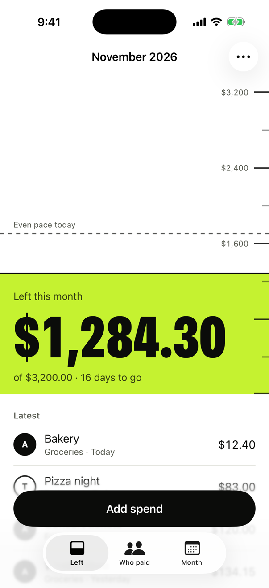
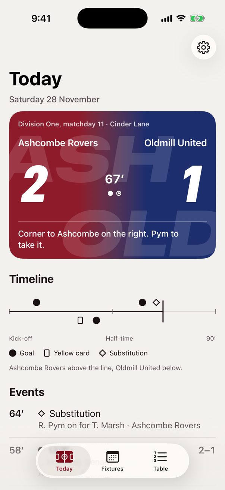
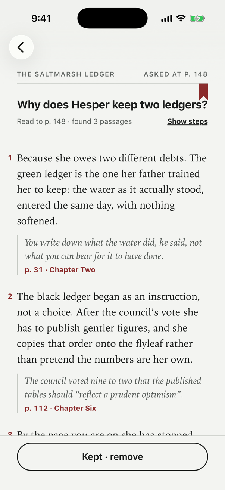

# Examples

Three apps, each built by a coding agent using taste-mobile from a short brief. Nothing was dealt
with a seed and nothing was re-dealt. Each folder holds the source, the filled-in
`MOBILE-DESIGN.md`, the critique, the gate result and every screenshot.

| Example | Stack | Kind | Direction dealt | Gate |
|---|---|---|---|---|
| [shared-budget](shared-budget/) | SwiftUI | money | Loud Owned Shell | `PASS  0 fail, 1 open, 1 warn` |
| [match-day](match-day/) | SwiftUI | sports | Broadcast Scoreboard | `PASS  0 fail, 1 open, 3 warn` |
| [reading-assistant](reading-assistant/) | Expo (React Native) | chat-ai | Typographic Writing Surface | `PASS  0 fail, 1 open, 1 warn` |

<table>
<tr>
<td></td>
<td></td>
<td></td>
</tr>
</table>

## Read these honestly

- **The open item in every gate is motion, haptics and sound.** Stills cannot show them, and no
  one ran these apps on a phone.
- **An agent looked at the screenshots, not a designer.** Each README lists the weak spots the
  agent found and did not fix.
- **iOS simulator only** (iPhone 17 Pro, iOS 26.5). No Android build was made.
- **They were built with 0.1.0 as first published.** Their runs found faults in the skill that
  are now fixed, so a new run prints slightly different warnings: system bar buttons are no
  longer flagged as small targets, and a comment no longer hides a fixed-size font warning.
- All names, clubs, people and book text are invented.

## Build one

```sh
cd examples/shared-budget && ./build.sh <simulator-udid>     # SwiftUI, needs Xcode only
cd examples/reading-assistant && ./build.sh <simulator-udid> # Expo: npm install, prebuild, Release build
```

[deals/](deals/) is something else: one brief dealt four ways, to show what the dealer changes.
