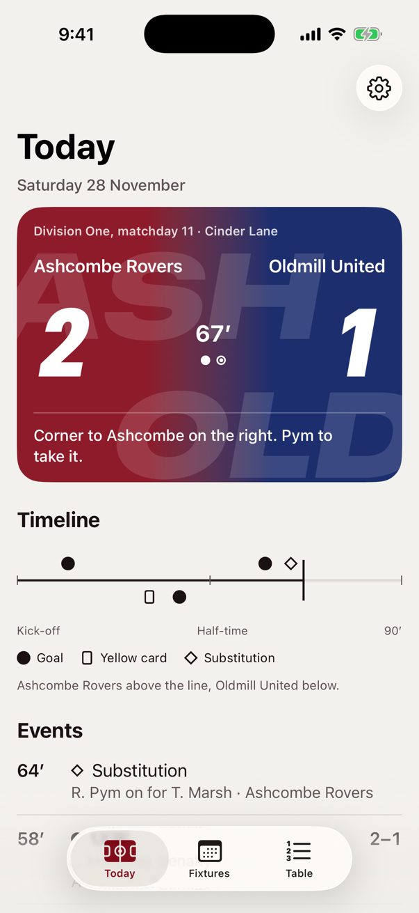
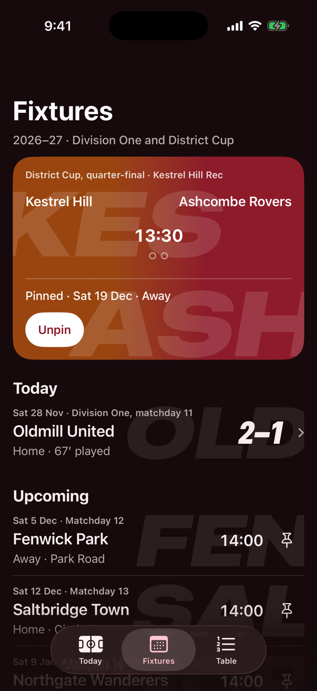
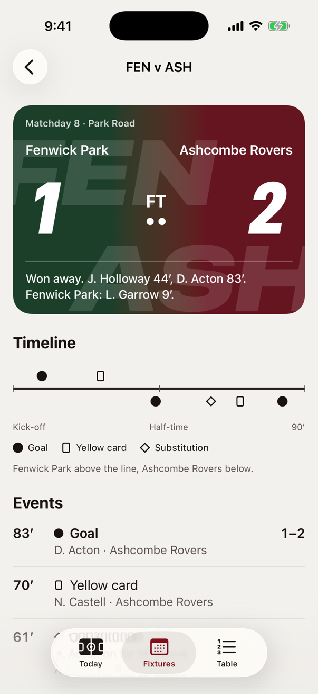
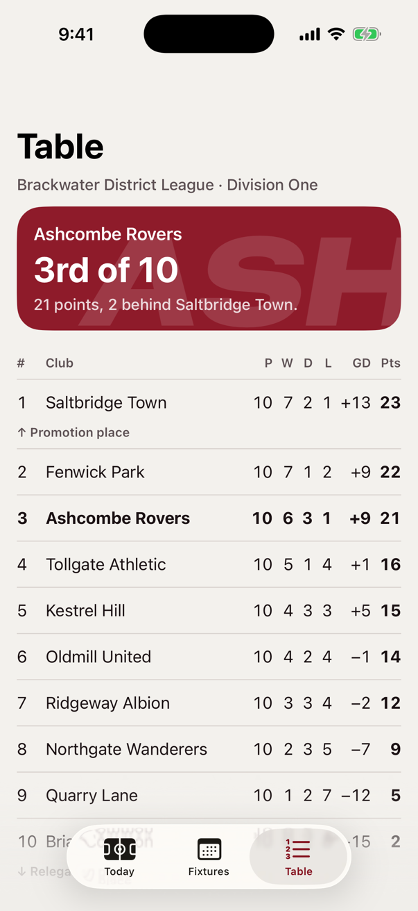

# Scoreboard End

An example iPhone app built with the taste-mobile skill. SwiftUI, iOS 26, no network, fixed sample data. Every club, player, ground and league in it is invented.

## The brief

> Build an iPhone app for supporters of one amateur football club. They want the live score of today's match, the fixtures and results for the season, and the league table.

## The deal

- Dealer flags: `--kind sports --audience general --platform ios --stack swiftui`
- Seed: 342190
- Direction taken: `broadcast-scoreboard` (Broadcast Scoreboard, the fandom variant of Glance Board)
- The other hand: `glance-board` (Glance Board). The sports kind dealt two hands, not three.
- Governing asset: slanted team-code watermarks behind the score
- Display treatment: condensed slanted score numerals with dots beneath (here: one dot per half)

## Design

- Governing metaphor: in this app, a match becomes the painted scoreboard at the end of the ground.
- Restraint rule: only one surface per screen is flooded with team colour; every other game carries its
  code as an ink watermark on the plain ground, and the table stays neutral.
- Hero moment 1: pinning a game to the top of the fixtures board (expressive spring, medium impact haptic
  when it lands, crossfade under Reduce Motion).
- Hero moment 2: the game goes final (the board settles darker on an expressive spring, no haptic, no sound).
- The full contract is in [MOBILE-DESIGN.md](MOBILE-DESIGN.md).

## Screens

| Today | Fixtures | Match | Table |
| --- | --- | --- | --- |
|  |  |  |  |

All 18 screenshots (six screens in light, dark and largest text) are in `screenshots/`.

## Build and run

Needs Xcode 26 and an iOS 26 simulator. `build.sh` compiles with `swiftc`; the app reads `-screen` and `-state`.

```sh
./build.sh <simulator-udid>                  # build, install, open Today
./build.sh <simulator-udid> fixtures         # today | fixtures | match | table
./build.sh <simulator-udid> today empty      # states for today: live | final | empty | error
```

## Gate

`GATE: PASS  0 fail, 1 open, 3 warn, 0 waived` after three capture rounds (the limit).

- Open, G25: motion, haptics and sound cannot be judged from stills.
- Warn, C10 (three times): the system toolbar Settings button on Today reports a 36x36 pt accessibility
  frame. It is the system's own glass toolbar button and was left as it is.
- Lint: `LINT: PASS  0 fail, 0 warn, 0 waived`. Two fixed-size font helpers in `Tokens.swift` carry a
  `taste-mobile-ignore A03` comment; the lint skips that rule for the file and does not count them as waived.

## Checked / Not checked

Checked, by looking at screenshots from an iPhone 17 Pro simulator on iOS 26.5:

- All six screens in light, dark and at the largest accessibility text size. Nothing is clipped or truncated.
- The empty state (`-state empty`) and the error state (`-state error`).
- The league table adds up: 50 matches, 144 goals for and 144 against.

Not checked:

- Motion, haptics and sound were not checked on a device. Neither hero animation was watched running.
- Hero moment 2 cannot happen with fixed data; `-state final` shows only its end state and was not captured.
- Reduce Motion, VoiceOver and Increased Contrast were written for but not run. No device, no other iPhone size.
- Known rough spot: a result row's score sits on top of the row's watermark. It is legible but busy.
