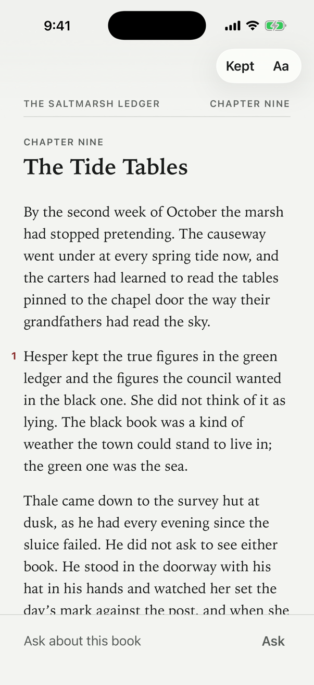
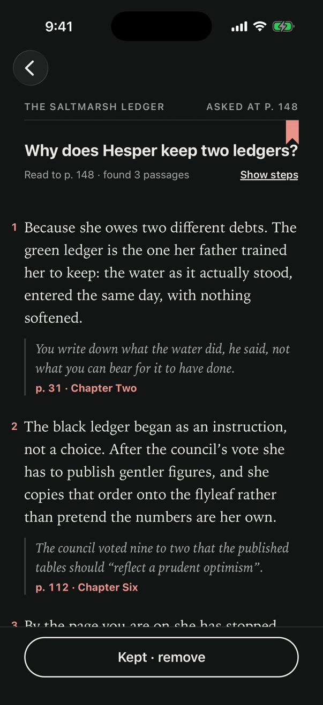
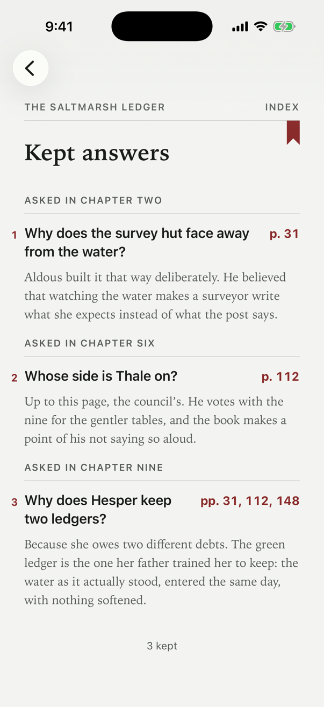
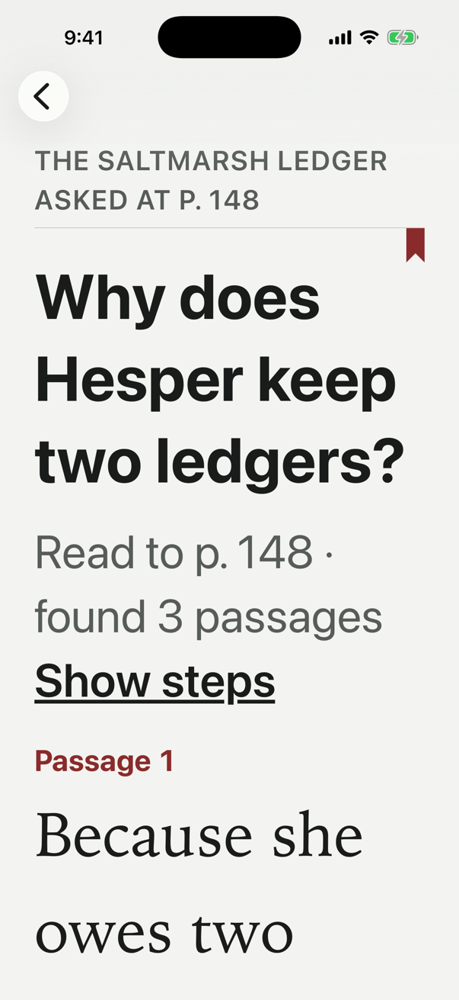

# Margin Notes (reading-assistant)

An example app built with the taste-mobile skill, in Expo (React Native), iOS only.
The book ("The Saltmarsh Ledger" by Odile Marrenby), its author and all of its text are invented.
There is no network and no model: answers are fixed sample data streamed from a local array.

## Brief (verbatim)

> Build an iPhone app where a reader asks an AI assistant questions about the book they are reading. They want to ask a question, get an answer that points to passages in the book, and keep their saved answers.

## Deal

- Flags: `--kind chat-ai --audience general --platform ios --stack expo`, no `--seed`, no re-deal.
- Seed 641548. Direction taken (hand 1): Typographic Writing Surface.
- Other two hands: Dark Pro Minimal, Literary Warm Assistant.

## Design

- Governing metaphor: "In this app, an answer becomes a footnote set on the page of the book it is about."
- Full record: [MOBILE-DESIGN.md](MOBILE-DESIGN.md). Restraint rule: "Never put an answer in a bubble, a card or a thread: it is set on the page, and the accent is spent only on the numerals and page references that point into the book, plus the ribbon of a kept answer."
- Hero moment 1: the chrome recedes when the ask line takes focus.
- Hero moment 2: a ribbon drops from the running-head rule when an answer is kept (success haptic after the write).

## Screenshots

| Book page | Answer | Kept index | Answer, largest text |
| --- | --- | --- | --- |
|  |  |  |  |

All 24 (8 screens in light, dark and largest text) are in `screenshots/` at half size. Full-size files are not in the repo: `capture.mjs run` writes them to `.taste-mobile/shots/`.

## Build and run

Needs Xcode with an iOS simulator runtime, Node and CocoaPods. No Metro: the JS bundle is embedded in a Release build.

```sh
./build.sh <simulator-udid>     # npm install, expo prebuild -p ios, xcodebuild Release, simctl install
xcrun simctl launch <simulator-udid> dev.tastemobile.examples.readingassistant -screen answer -state streaming
```

Screens open directly from launch arguments, read in `src/launch.ts` with React Native's `Settings.get`
(launch arguments land in the NSUserDefaults argument domain; no native code is needed):

| Screen | Arguments |
| --- | --- |
| book | `-screen book` |
| answer | `-screen answer`, plus `-state streaming` or `-state error` |
| passage | `-screen passage -passage 2` |
| kept | `-screen kept`, plus `-state empty` |
| type | `-screen type` |

## Gate

`GATE: PASS  0 fail, 1 open, 1 warn, 0 waived` after three captures and two fix rounds (the gate script was run twice; its own counter reads round 2 of 3). Lint: `PASS 0 fail, 0 warn, 0 waived`.

- Open (G25): motion, haptics and sound cannot be judged from stills.
- Warn (C10): on the type sheet, the system "Sheet Grabber" (73x24) and the "Done" bar item (55x42) report accessibility frames under 44x44 pt. Not waived.

## Checked / Not checked

Checked:
- Every screenshot of the final capture was opened and read: 8 screens in light, dark and the largest text size.
- Lint and gate scripts; accessibility trees saved by capture (target sizes only). A Release build with an embedded bundle launches each screen from launch arguments.

Not checked:
- Motion, haptics and sound were not checked on a device. The hero moments, the word-by-word stream and the reduced-motion branch were read as code only. The app has no sound.
- VoiceOver was not run. No physical device was used. Android was not built. Typing a question by hand and the "found no passages" state were not captured.
- Known rough edges are listed in `.taste-mobile/critique.md` (largest-text book page is cramped; empty and error states put their button high; type sheet cuts its last row at the first detent).
