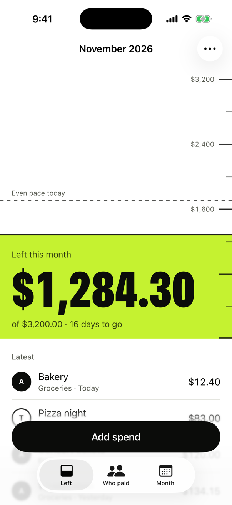
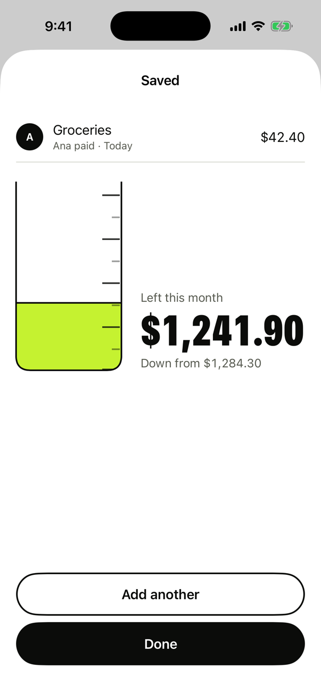
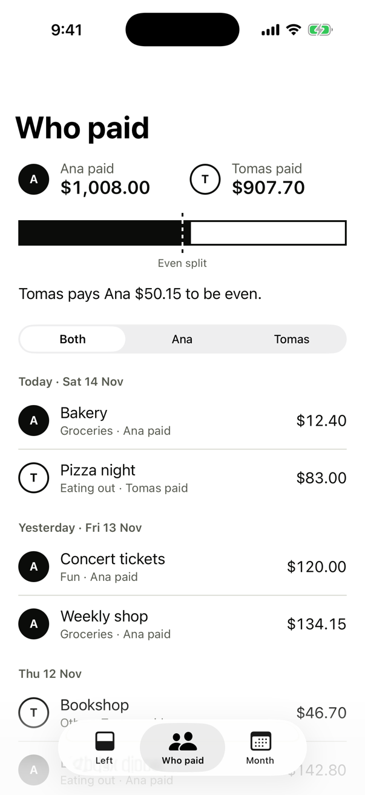
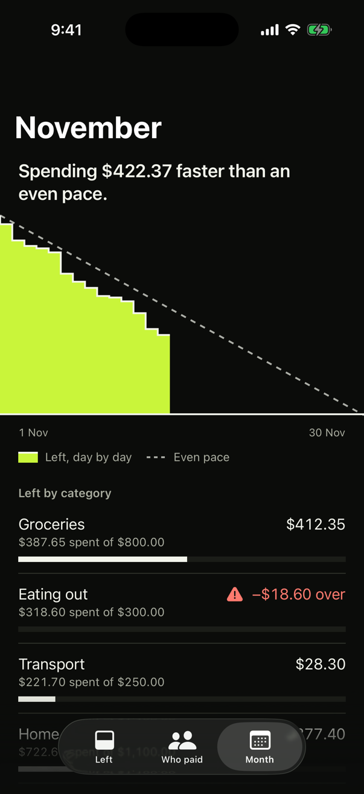

# Jugful (shared-budget)

An example iOS app built with the taste-mobile skill. SwiftUI, iOS 26, no Xcode project.

## Brief

> Build an iPhone app for a couple who share one monthly budget. They want to see at a glance what is left this month, add a spend in a few seconds, and see who paid for what.

## The deal

- Dealer flags: `--kind money --audience general --platform ios --stack swiftui`
- Seed: 547688
- Direction taken: Loud Owned Shell (`loud-owned-shell`)
- Other two hands: Glance Board (`glance-board`), Dark Pro Minimal (`dark-pro-minimal`)

## Design

- Governing metaphor: in this app, the month's budget becomes a measuring jug the two of you pour from.
- Restraint rule: only what is left is ever lime; spends, people, categories, buttons, the entry sheet and every status stay ink, red or plain ground.
- Governing asset: the level. A lime fill whose height is the share of the budget left, an ink level line, graduation ticks, and a dashed "even" mark. It appears on Home, on the saved result and as the Month chart.
- Hero moment (one): after a spend is saved, the level settles at its new mark (0.5 s, no bounce) with a success haptic. No sound.
- People are told apart by shape, not colour: Ana is a solid monogram, Tomas an outlined one. Full spec: `MOBILE-DESIGN.md`.

## Screens

| Screen | Launch arguments |
| --- | --- |
| Home (what is left) | none |
| Home, empty month | `-state empty` |
| Home, over budget | `-state over` |
| Add spend | `-screen add` |
| Saved result | `-screen add -state saved` |
| Who paid | `-screen paid` |
| Month | `-screen month` |






All 21 captures (7 screens in light, dark and largest text) are in `screenshots/` at half size. Full-size files are not in the repo: `capture.mjs run` writes them to `.taste-mobile/shots/`.

## Build and run

Needs Xcode with the iOS 26 simulator SDK. Sample data is fixed, the clock is fixed at Sat 14 Nov 2026, and there is no network.

```sh
./build.sh <simulator-udid>                 # build, install, launch Home
./build.sh <simulator-udid> -screen month   # launch a given screen
```

## Gate

`GATE: PASS  0 fail, 1 open, 1 warn, 0 waived` after three capture rounds (two fix rounds).

- Open, G25: motion, haptics and sound cannot be judged from stills.
- Warn, C10: the system "Cancel" button in the sheet toolbar reports a 77x36 pt accessibility frame.

## Checked / Not checked
Checked:
- Lint passes with 0 fail, 0 warn.
- Every screenshot of the final capture was looked at: 7 screens in light, dark and the largest text size.
- Largest text: defects found in rounds 1 and 2 (overlapping labels, covered content, a wrapped amount) were fixed and re-captured.

Not checked:
- Motion, haptics and sound were not checked on a device. The save animation and the success haptic were read in code only.
- VoiceOver, increased contrast, reduce motion, right-to-left, iPad, landscape, small phones, and the hit region of the "Cancel" toolbar button.
- Who paid and Month with no spends, and the over-limit line on the add sheet, were not captured.
- Known weak spots (`.taste-mobile/critique.md`): the add sheet reads as a stock form, the saved result has an empty lower third, and at the largest text size the keypad is below the fold.
